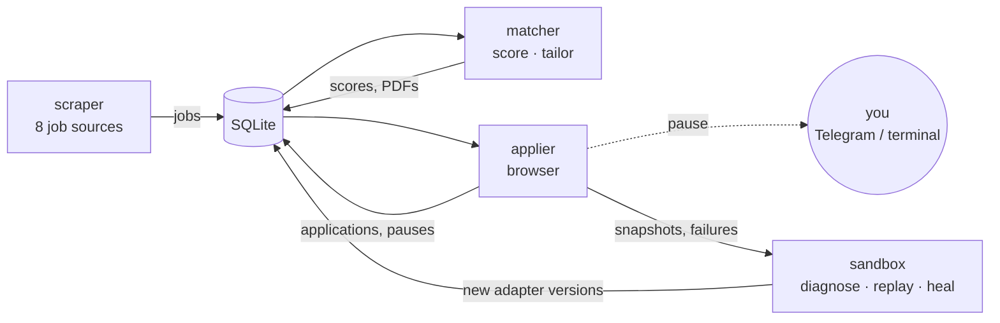

# sachin-agent

A self-improving job application agent. It finds jobs, scores them against a
verified profile of you, writes a tailored resume and cover letter that only
state things you actually did, fills the application form in a browser, and
**stops for you** before anything irreversible: CAPTCHAs, logins, consent,
unknown questions, and the final submit. Every failure is captured with enough
evidence to be replayed offline, so the agent can repair itself without
experimenting on live sites.



## Status

| Stage | Phases | State |
|---|---|---|
| Foundation | 0–2: repo and boundaries, profile, database | ✅ done |
| Core agent | 3–9: scraper v1/v2, matcher, tailor, applier, human-in-the-loop, orchestration | ✅ done |
| Self-improvement prerequisites | 10–12: snapshots, failure diagnosis, replay sandbox | ✅ done |
| Self-improving layer | 13: selector healing | ✅ done |
| | 14–16: skill library, adapter synthesis, teaching UI and metrics | ⬜ not started |

227 tests, ruff + mypy clean. See [docs/status.md](docs/status.md) for what was
verified live, what wasn't, and the known limitations.

## Quickstart

```bash
uv venv && source .venv/bin/activate
make init                      # uv pip install -e ".[dev]"
playwright install chromium    # browser for tailoring PDFs and applying
cp .env.example .env           # add GROQ_API_KEY or OPENAI_API_KEY
sachin-agent-db init           # create / migrate data/sachin-agent.db

# 1. Your profile: the only source of facts about you
sachin-agent-profile import path/to/cv.pdf     # or examples/dummy_cv.md
#    then edit profile-data/profile.json: preferences, work_authorization,
#    answers; set "finalized": true
sachin-agent-profile validate
sachin-agent-profile facts --evidence           # what the LLM is allowed to cite

# 2. Find, score, review
sachin-agent-scraper run
sachin-agent-matcher run --limit 50
sachin-agent-matcher review                     # approve / reject with reasons

# 3. Tailor and apply (pauses before submit)
sachin-agent-matcher tailor --approved 5
sachin-agent-applier run <job-id> --headed --interactive

# Or all of it, unattended, nightly
sachin-agent-run run-all
make install-timer                              # systemd user timer, 02:00
```

## Documentation

| Read this | To understand |
|---|---|
| [docs/architecture.md](docs/architecture.md) | The modules, why they never import each other, how data flows, the state machines |
| [docs/how-it-works.md](docs/how-it-works.md) | Each stage in depth: sources, dedup, scoring, tailoring, adapters, pauses, orchestration |
| [docs/anti-hallucination.md](docs/anti-hallucination.md) | The fact database, citations, and the verifier that keeps the LLM honest |
| [docs/self-improvement.md](docs/self-improvement.md) | Snapshots, signatures, failure diagnosis, offline replay, selector healing |
| [docs/usage.md](docs/usage.md) | Setup, every setting, every command, daily workflows, troubleshooting |
| [docs/data-model.md](docs/data-model.md) | Every table and field, migrations, the frozen-schema rule |
| [docs/safety.md](docs/safety.md) | The non-negotiable constraints and where each is enforced in code |
| [docs/status.md](docs/status.md) | Phase-by-phase status, live verification, deviations from the brief, limitations |

## Repository layout

```
scraper/        job sources (APIs + opt-in logged-in browse cluster) → normalized, deduplicated jobs
matcher/        scoring, review, calibration, resume/cover-letter tailoring
applier/        browser session, adapters, human-in-the-loop, snapshots
orchestrator/   run-all: runs the module CLIs as subprocesses
sandbox/        offline tools: replay, suites, diagnosis, healing
shared/         data contracts, DB, config, LLM config, logging, facts
migrations/     Alembic migrations (SQLite, batch mode)
tests/          pytest; offline, never reach a real LLM or Telegram
deploy/systemd/ nightly timer
examples/       dummy_cv.md for trying it without your real CV
```
