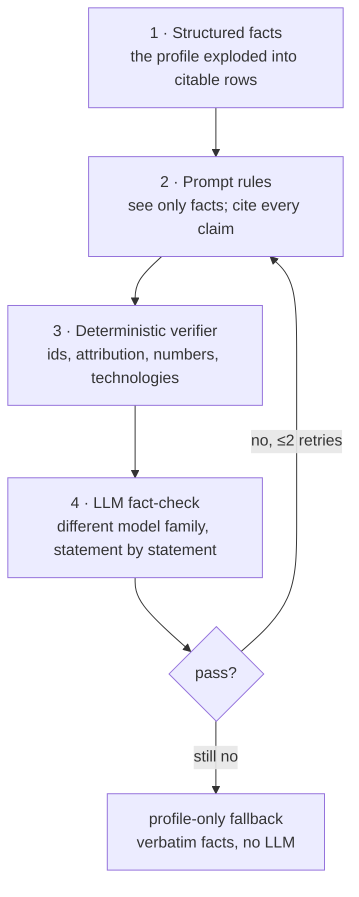

# Keeping the LLM honest

An agent that writes resumes and answers application questions on your behalf
must never claim something you didn't do. "Tell the LLM not to fabricate"
isn't enough: live tests here caught invented arithmetic ("improved latency by
850 ms", when the fact says 800→120 ms), inflated scope ("millions of
transactions" for "3M/day"), skills copied from the job description, and a
made-up fact id. So there are four layers, and each one assumes the previous
ones failed.

## Layer 1: the fact database

`shared/profile/facts.py`, table `profile_facts`, CLI `sachin-agent-profile facts`.

The profile isn't handed to the LLM as a JSON blob. Every save explodes it into
**atomic facts**, one row each:

| Kind | Example text |
|---|---|
| experience | `Senior Backend Engineer at Razorpay, Apr 2022 – Present` |
| experience_bullet | `At Razorpay: Cut p99 latency of the settlement API from 800ms to 120ms…` (child of its experience) |
| technology | `Used Kafka at Razorpay` (child of its experience) |
| skill | `Skill (languages): Go` |
| education, project, certification | `B.E. Computer Science, PES University, Bengaluru (2015 – 2019)` |
| work_authorization | `Requires visa sponsorship to work outside India` |
| preference | `Target role: Backend Engineer`, `Minimum acceptable salary: 4500000` |
| answer | `Q: What is your notice period? A: 60 days` |
| identity | `email: …` (**PII**), `Based in Bengaluru, India` |

Each fact has:

- **A stable id**: `F` + 10 hex digits from `sha256(kind | natural key)`. The
  natural key is what the fact *is* (company + title + start date for a job;
  the bullet text plus its job for a bullet), not its position. Reordering
  doesn't change ids; editing a bullet creates a new fact.
- **Evidence**: the CV line it was found on. Child facts search from their
  parent's line, so "Used Go at Razorpay" cites a line inside the Razorpay
  section, not the first "Go" in the CV.
- **A PII flag**: contact details are needed to fill forms, but `format_facts_for_prompt`
  *raises* if one is ever passed to a prompt.
- **verified**: true once you finalize a profile containing it.
- **active**: facts removed from the profile go inactive and are **never
  deleted**, so a resume made last month can still show its sources.

Facts re-sync on every profile load, so a wording fix in code reaches the DB
immediately. That mattered: the original sponsorship fact read "Requires visa
sponsorship" with no scope, and the scorer rejected a Bengaluru job on visa
grounds for a candidate authorized in India. It now reads "…to work outside India".

## Layer 2: prompt rules

The LLM sees only `[F…] (kind) text` lines, and every prompt states the same
contract. From `tailor_resume_v2`:

- every bullet and sentence lists, in `fact_ids`, the facts it states;
- a bullet under a role may only use **that role's** facts; never move an
  achievement to another employer;
- every number, technology and company name must appear in the cited facts;
- don't claim a job requirement the facts don't state ("missing a requirement
  is fine; claiming it falsely is not");
- no adjectives the facts don't support.

Scoring has the same shape (`score_job_v3`): every statement about the
candidate cites facts, and "if no fact supports something, the candidate does
not have it".

## Layer 3: the deterministic verifier (free)

`matcher/verifier.py` checks every line of a draft before any paid check.

| Rule | Catches |
|---|---|
| `uncited` | a line with no `fact_ids` |
| `unknown_fact` | a cited id that isn't a fact the LLM was shown (hallucinated ids, as seen live) |
| `pii_fact` | citing a contact detail |
| `misattributed` | a bullet under Delhivery citing a Razorpay bullet |
| `no_achievement` | a bullet citing only technology facts ("Built event pipelines with Kafka" invents the "built pipelines" part) |
| `invented_number` | a number not in the cited facts. Compared **by value**: `25k` = `25,000` = `25 thousand`; `800ms` is 800 |
| `invented_term` | a technology named in the line but not in the cited facts. The vocabulary is every skill/technology in your profile plus technology-looking job keywords. Short terms (`Go`, `AWS`) are case-sensitive, so the verb "go" doesn't count |
| `missing_role`, `duplicate_role`, `empty_role`, `unknown_role` | a resume that drops or duplicates a job |
| `unknown_skill` | the skills list cites something that isn't a skill or technology fact |
| `bad_output` | the provider returned malformed or truncated JSON (counts as an attempt) |

Cover letters add: a sentence marked `about="company"` must not cite candidate
facts, and its numbers and technologies must appear in the **job text**.

## Layer 4: the LLM fact-check

Only drafts that pass layer 3 get here. Every statement goes to a checker
with *only its own cited sources*: "is every claim — numbers, technologies,
scope, employer, outcome — stated or directly implied? Rephrasing is fine;
added specifics are not." A missing verdict counts as unsupported.

On Groq the checker is `qwen/qwen3.8-27b` while the writer is `gpt-oss`. A
checker from a different model family makes different mistakes, and draws on a
separate quota. Live, it caught "showcasing high-throughput distributed system
design", "improving system reliability and user experience", and "led a team
of 12" for "mentored 4 engineers".

## Retry, then fall back

A rejected draft is retried with its violations quoted back as feedback. After
2 retries, or immediately on a quota or auth error, the **profile-only
fallback** is used: verbatim bullets ranked by keyword overlap, skills in
profile order with the relevant ones first, no summary. Its own verification
must pass; if it ever didn't, that's a bug and tailoring raises.

So every resume is verified. The only question is whether it is *tailored*:
`tailored_documents.fallback` tells you.

## The same idea elsewhere

- **Form answers** (`applier/context.py`) come only from facts, your answers
  bank, or your remembered consents. LLM inference is accepted only with valid
  non-PII citations, confidence ≥0.85, and an answer that is one of the
  offered options. Anything else goes to you, and your answer becomes a fact
  for next time.
- **Profile import** checks the extracted profile against the CV text (invented
  values, dropped sections) and retries.
- **Scoring** records every cited id and flags unknown ones in review.
