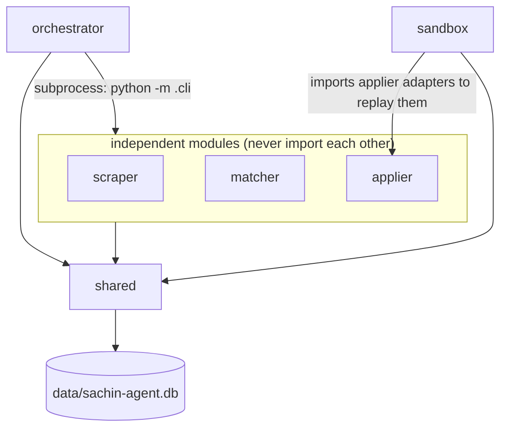
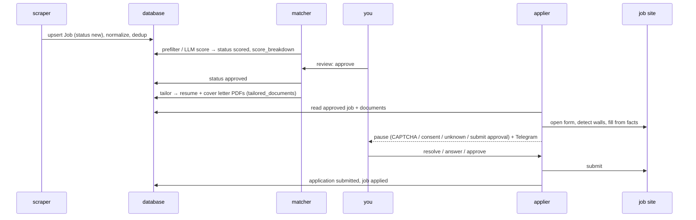
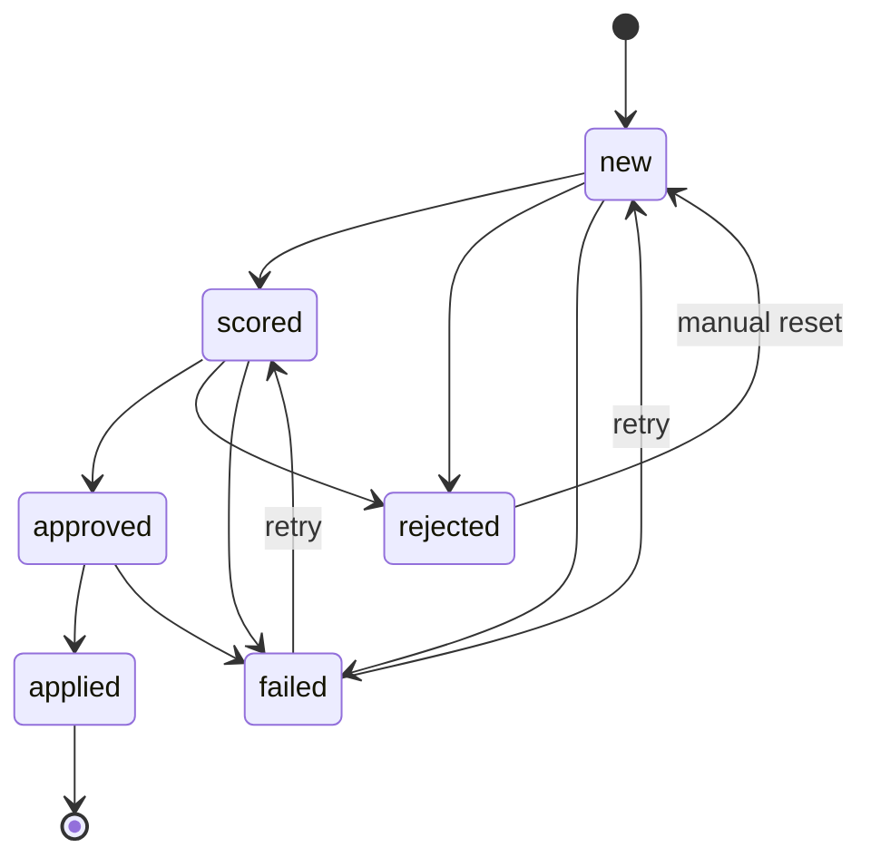
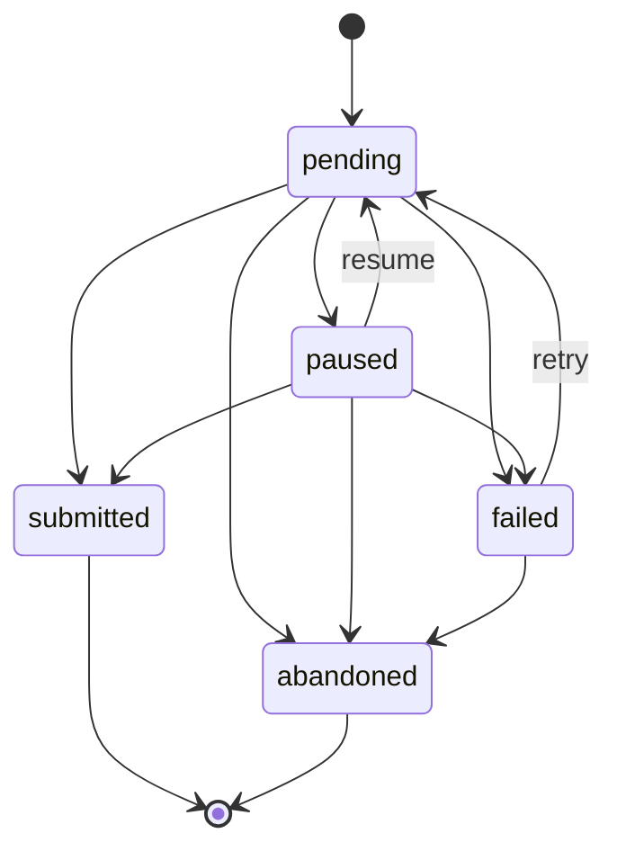

# Architecture

## The shape of the system

Three independent programs do the work, and two more support them:

| Module | Job | Writes | Reads |
|---|---|---|---|
| `scraper/` | Fetch jobs from job-board APIs, normalize, deduplicate | `jobs`, `source_health`, `snapshots` (API), `failures` | `scraper/companies.json` |
| `matcher/` | Score jobs, human review, tailor resumes and cover letters | `jobs.score*`, `jobs.status`, `jobs.requirements`, `tailored_documents`, `failures` | `jobs`, `profile_facts` |
| `applier/` | Fill application forms in a browser, pause for the human, submit | `applications`, `consent_choices`, `snapshots`, `adapter_versions`, `failures` | `jobs`, `tailored_documents`, `profile_facts` |
| `orchestrator/` | Run the whole pipeline on a schedule | `pipeline_runs` | counts only |
| `sandbox/` | Offline tooling: replay snapshots, diagnose failures, heal adapters | `failures.diagnosis`, `adapter_versions` | `snapshots`, `failures` |
| `shared/` | Data contracts (schemas), DB engine, config, LLM config, logging, profile store, facts | — | — |

### Why the modules never import each other

Coupling is what usually kills projects like this: a scraper change breaks the
applier, a matcher refactor breaks scraping. Here the boundary is **enforced by
a test**, not by discipline. `tests/test_boundaries.py` parses every file with
`ast` and fails on any of these:

- `scraper`, `matcher` or `applier` importing one of the other two;
- `orchestrator` importing any module (it runs their CLIs as subprocesses);
- `shared` importing any module or the orchestrator;
- anything importing `sandbox` (it is the applier's offline test harness: it may
  import applier adapters to replay them, but nothing at runtime depends on it).

All communication goes through the **database**. The scraper writes a `Job`;
the matcher later reads it, scores it and writes the score back; the applier
reads approved jobs and their tailored documents. Each module only needs the
shared schemas in `shared/schemas/`.

### What lives in `shared/`

Only things every module needs to agree on:

- `shared/schemas/*`: the data contract, one SQLModel class per table (a
  Pydantic model *is* the table), plus the state-transition rules.
- `shared/db/*`: engine, idempotent upsert, failure emission, dedup (which works
  only on keys the scraper stored), source health, the `db` CLI.
- `shared/config.py`: all settings, from `.env`.
- `shared/llm.py`: which provider, key and model to use per task, and the one
  structured-output call. Infrastructure, not logic.
- `shared/profile/*`: the profile store, CV extraction, and the **fact store**
  (see [anti-hallucination.md](anti-hallucination.md)).
- `shared/signature.py`: the definition of a snapshot signature (a stored
  contract field, like `make_job_id`).
- `shared/notify.py`, `shared/killswitch.py`, `shared/paths.py`, `shared/logging.py`.

## Data flow, end to end

## State machines

Status fields are never assigned directly. Every change goes through a
`transition()` function that raises on illegal moves.

**Job** (`shared/schemas/job_transitions.py`)

**Application** (`shared/schemas/application_transitions.py`)

A paused application always has a `pause_reason`: `captcha`, `login`,
`consent`, `unknown_field`, `submit_approval`, `kill_switch` or
`adapter_approval`.

## Identity and idempotency

- **Jobs**: `id = sha256(source | external_id)`. Re-scraping the same posting
  updates it in place. A whitelist of fields can be overwritten; status, score
  and history are never touched by a re-scrape.
- **Applications**: `id = sha256("application" | job_id)`. One application per
  job: running it again resumes it, never applies twice.
- **Tailored documents**: `id = sha256(job_id | kind)`. Re-tailoring replaces.
- **Profile facts**: `id = "F" + sha256(kind | natural key)[:10]`. The same fact
  keeps its id across saves and reorderings, so old citations still resolve.
- **Adapter versions**: `id = sha256(domain | v<N>)`.

So every stage can be re-run safely.

## LLM usage

All LLM calls go through `shared/llm.py`:

- **Provider**: OpenAI or Groq (OpenAI-compatible). Whichever key is set is used,
  unless `LLM_PROVIDER` overrides it.
- **Structured output only**: `responses.parse(text_format=Model)`. Free text is
  never parsed.
- **Per-task model and settings**: each task (extraction, scoring, keywords,
  resume, cover_letter, verify, form_answer, diagnose, heal) has its own model,
  reasoning effort and output budget. Groq quotas are per model, so cheap tasks
  run on `gpt-oss-20b`, writing on `gpt-oss-120b`, and verification on a
  *different model family* (`qwen3.8-27b`) so writer and checker make different
  mistakes. Override any of them with `LLM_MODELS='{"task": "model"}'`.
- **Error classes**: errors map to failure classes, which drive what happens
  next. A quota error (`rate_limit`) stops the run. Malformed output
  (`semantic_mismatch`) costs one retry. Network errors are `transient`.
- **Versioned prompts**: every prompt carries a version (`score_job_v3`,
  `tailor_resume_v2`, …) that is stored with its output, so results can be
  correlated with the prompt that produced them.
- **Key safety**: the API key is excluded from the config's printed form, and
  tests blank all keys, so they can never call a real API.
