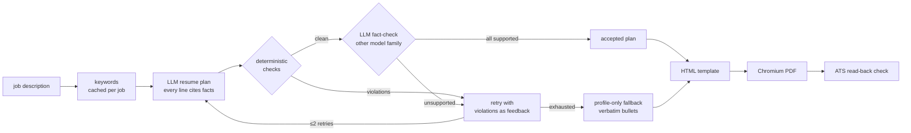
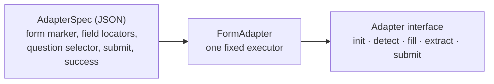

# How it works, stage by stage

This follows a job from the moment it's scraped to the moment it's submitted.
For the anti-fabrication design see [anti-hallucination.md](anti-hallucination.md);
for snapshots, diagnosis and healing see [self-improvement.md](self-improvement.md).

---

## 1. Profile: the single source of truth about you

`shared/profile/`, CLI `sachin-agent-profile`.

1. **Import.** `sachin-agent-profile import cv.pdf` extracts text (PDF, DOCX,
   TXT or MD) and asks the LLM to transcribe it into the `Profile` schema
   (prompt `extract_profile_v1`: copy, don't embellish).
2. **Faithfulness check.** `shared/profile/faithfulness.py` compares the draft
   with the CV text:
   - every company, title, school, certification, project and skill must appear
     in the CV, or it's flagged as *possibly invented*;
   - a CV section ("Skills", "Experience", "Education") that came back empty is
     flagged as *possibly dropped*.

   Extraction retries up to 3 times and keeps the draft with the fewest issues;
   whatever remains is printed for you to check. This exists because a live run
   once dropped every skill.
3. **You finish it.** The CV doesn't contain your preferences
   (`target_titles`, locations, salary floor, excluded companies), your work
   authorization, or answers to common application questions (`answers`:
   notice period, relocation, expected pay…). Add these to
   `profile-data/profile.json`.
4. **Finalize.** Set `"finalized": true`. The schema refuses this until
   name, email and at least one experience or education entry exist, and
   unknown fields are rejected outright (`extra="forbid"`). Scoring, tailoring
   and applying all refuse to run on a draft.
5. **History.** Every save is a numbered version in `profile_records`. Editing
   the JSON by hand is detected on the next load and saved as a new version.
   `history` and `restore N` let you go back. `import` refuses to overwrite an
   existing profile unless you pass `--force`.

Every save also re-derives the **fact table** (`profile_facts`), the citable
form of your profile. See [anti-hallucination.md](anti-hallucination.md).

---

## 2. Scraper: finding jobs

`scraper/`, CLI `sachin-agent-scraper`.

### Sources

| Source | Endpoint | Board means | Notes |
|---|---|---|---|
| greenhouse | `boards-api.greenhouse.io/v1/boards/{slug}/jobs` | company slug | display name from `company_name` |
| lever | `api.lever.co/v0/postings/{slug}` | company slug | dates are epoch milliseconds |
| ashby | `api.ashbyhq.com/posting-api/job-board/{slug}` | company slug | |
| workable | `apply.workable.com/api/v1/widget/accounts/{slug}` | company slug | |
| smartrecruiters | `api.smartrecruiters.com/v1/companies/{Id}/postings` | company id (case-sensitive) | paginated; descriptions fetched per job with 4 parallel requests; ≤1000 per board |
| remoteok | `remoteok.com/api` | tag or `all` | aggregator; ToS: link back |
| remotive | `remotive.com/api/remote-jobs` | category or `all` | aggregator; ToS: ≤4 calls a day, so at most one run every 6h |
| arbeitnow | `arbeitnow.com/api/job-board-api` | `all` | aggregator; ≤3 pages |

Boards come from `scraper/companies.json` (copy `companies.example.json`).
Aggregators fall back to their default board when none is configured.

### One board, step by step (`scraper/runner.py`)

1. **Politeness.** A board scraped successfully within its source's minimum
   interval is skipped (`--force` overrides).
2. **Fetch** with a retrying JSON client (`BaseSource.get_json`):
   - 429 and 5xx responses are retried with exponential backoff;
   - `Retry-After` is honoured but capped at 120s, so one bad header can't
     stall a night;
   - other 4xx responses fail immediately. Every error carries a provisional
     failure class.
3. **Enrich** (SmartRecruiters only): fetch the per-job details the list
   endpoint lacks. One failed detail costs that job its description, not the
   whole board.
4. **Snapshot** the raw payload (`snapshots/scrape-…/api/<source>-<board>.json`),
   whose signature fingerprints the JSON *schema* (see self-improvement).
5. **Normalize** each raw job into the frozen `Job` schema, then compute
   canonical keys (`scraper/normalize.py`):
   - **title**: lowercase, accents folded, gender markers removed (`(m/w/d)`),
     abbreviations expanded (`Sr.`→senior, `ML`→machine learning, `SWE`→software
     engineer), work-arrangement words dropped;
   - **company**: punctuation and legal suffixes removed and joined
     (`Hugging Face` = `huggingface`, `Stripe, Inc.` = `stripe`);
   - **location**: split multi-locations, aliases resolved (`blr`/`Bangalore`→bengaluru,
     `NYC`→new york, `München`→munich), remote variants → `remote`
     (`"Bengaluru | remote"`).
6. **Upsert** idempotently. A failure on one job is recorded and the rest continue.
7. Record the board's run in `source_health`; emit a `FailureEvent` on errors.

### Browse cluster: logged-in sites (opt-in)

`scraper/browse/`, CLI `sachin-agent-scraper browse-login SITE` and
`sachin-agent-scraper browse [SITES…] --ok`.

Sites with no public jobs API (LinkedIn so far) are read through **your own
logged-in browser session**. This is a deliberate exception you opted into;
see [safety.md](safety.md#the-browse-cluster-exception).

1. `browse-login linkedin` opens a visible browser at the login page. You log
   in yourself (2FA included); the window closes once you're in. Only the
   browser profile's session cookies are kept, locally in `browser_profile/`.
2. `browse --ok` runs every site in the cluster (`scraper/browse/__init__.py`)
   with the searches in `scraper/browse.json`: default `"AI engineer"` ×
   `Delhi, India` / `Bengaluru, India` / `Remote` (remote = LinkedIn's remote
   filter for jobs open to `remote_country`), past week, 2 result pages each.
   `-q`, `-l` and `--pages` override it for one run.
3. For each results page: open the site's own search URL → wait a random 4–9s
   → **checkpoint check** → scroll each card into view → read id, title,
   company and location using the site's **listing spec**
   (`scraper/browse/specs/linkedin.json`: data, healable like adapters). If the
   spec matches nothing, a fallback reads any `/jobs/view/<id>` link. Up to
   `details` (default 20) new cards per run are clicked (on a non-link part,
   so the page never navigates) to read their description.
4. Jobs go through the same normalize → upsert → dedup path as every source
   (`source = "linkedin"`); each page is snapshotted.
5. **Checkpoint** (login redirect, security check, a *visible* challenge): the
   run stops at once, snapshots the page, records an `auth_wall`/`captcha`
   failure, and messages you. Nothing is retried. LinkedIn embeds a hidden
   bot-detection sensor on every page; it's ignored because it isn't a
   challenge, but it means LinkedIn sees automation.

### Dedup (`shared/db/dedup.py`)

After every run, all jobs are re-clustered **within each company**:

- **Across sources**: duplicate if title similarity (`token_sort_ratio`) is at
  least 92 and the locations overlap (unknown matches anything).
- **Within one source**: only identical title, location *and* description.
  One ATS listing the same title twice is usually two different teams (seen
  live: ServiceNow lists 5 "Senior Software Engineer, Hyderabad" roles).
- **Canonical copy**: direct ATS sources win over aggregators (they have the
  real apply link), then the earliest seen. Others get `duplicate_of` set.
  Downstream modules skip duplicates.

It's a full recompute, so it's idempotent. Live: 23 duplicates out of 3,958
jobs (0.6%), each one checked by hand.

---

## 3. Matcher: scoring

`matcher/scoring.py`, CLI `sachin-agent-matcher run | review | stats`.

1. **Load the candidate**: the finalized profile, its version, and the
   **non-PII facts**.
2. **Prefilter (free).** A job skips the LLM, scoring 1.0 with the reason recorded, if:
   - its company is in `excluded_companies` (legal suffixes ignored); or
   - its title lacks the **head noun** of every target title. For "Backend
     Engineer" the job must say engineer (developer and engineering count). A
     generic head ("Member of Technical *Staff*") requires the whole phrase, so
     "Chief of Staff" doesn't match.

   Two earlier rules failed on real data and are documented in the code. Live,
   the prefilter sends about a third of jobs to the LLM and drops zero
   engineering titles for an engineering target.
3. **Prioritize.** Your daily LLM quota is spent first on jobs in your
   preferred locations, then remote jobs (if you're open to remote), then newest.
   `--limit` caps *LLM calls*; prefiltered jobs are free and always processed.
4. **LLM rubric** (`score_job_v3`): six dimensions, each a 1–5 score with a
   reason and **cited fact ids**:

   | Dimension | Default weight |
   |---|---|
   | role_match | 0.30 |
   | skills_overlap | 0.25 |
   | seniority | 0.15 |
   | location | 0.15 |
   | visa | 0.10 |
   | compensation | 0.05 |

   The prompt includes today's date, so "years of experience" is computed, not
   guessed. "Unknown" scores a 3 rather than a guess.
5. **Overall score** is computed in code: a weighted mean. If **location or
   visa scores 1**, the overall is capped at **1.5**: a job you can't legally
   or physically take isn't "pretty good" because the skills match.
6. **Citations checked.** Any cited id that isn't a fact the LLM was shown
   (invented, malformed, or PII) is stored in `citation_issues` and flagged in
   review.
7. **Stored** in `Job.score_breakdown` with provenance: method, prompt version,
   model, weights and profile version. Status moves new → scored via
   `transition()`.
8. **Errors.** Failures are recorded and the job stays `new` for the next run.
   A quota error stops the run instead of failing every remaining job.

**Review.** `review` shows the top-N with every reason and its citations, and
asks you to approve, reject, skip or quit for each. `approve`/`reject <id-prefix>`
do the same one job at a time.

**Calibration.** `calibrate label` shows you jobs spread across the score range
*without* the LLM's score, and records your own 1–5. `calibrate report`
measures agreement (within ±1), fits new weights by projected gradient descent
on the simplex, and `--apply` saves them only if they agree with you better.

---

## 4. Matcher: tailoring

`matcher/tailor.py`, CLI `sachin-agent-matcher tailor <id> | --top N | --approved N`.

1. **Requirements**: must-haves, nice-to-haves and keywords are extracted from
   the JD on the small model and cached in `Job.requirements`.
2. **Resume plan**: the LLM picks and rephrases bullets; every line lists the
   fact ids it states. Header, employers, titles, dates and education are
   rendered from facts directly; the LLM never writes them.
3. **Verification**, then up to 2 retries, then the fallback. Full detail in
   [anti-hallucination.md](anti-hallucination.md).
4. **Rendering**: `matcher/templates/resume.html.j2` is single-column with
   system fonts and no tables, images or icons. It's rendered to an A4 PDF by
   headless Chromium with **all network blocked**.
5. **ATS check**: the PDF text is extracted with `pypdf`. Every expected line
   must read back, in order. No images, at most 2 pages. Hyphens split across
   a line break are rejoined, as real parsers do.
6. **Saved** to `profile-data/resumes/<job_id>.pdf` (plus the cover letter in
   `cover_letters/`), with a `tailored_documents` row recording every fact id,
   rejected-draft violations, attempts, fallback flag, prompt, model and
   profile version.

Cover letters use the same loop. A sentence is either about the candidate
(must cite facts) or about the company (may only state what the job text says).
The fallback is a plain template made of verbatim facts.

---

## 5. Applier: filling the form

`applier/`, CLI `sachin-agent-applier`.

### Adapters are data, not code

A site adapter is a JSON spec (`applier/adapters/specs/greenhouse.json`), run
by a single fixed executor (`applier/adapters/form.py`). Each locator is
`{strategy: css|label|role|text, value, role?}`. Healing (Phase 13) and
synthesis (Phase 15) only ever produce **specs**, so self-modification can
change *where* the agent clicks, never *what code* runs.

The applier always uses the domain's **active version** (`adapter_versions`);
the built-in spec registers as v1 on first use.

### One application (`applier/runner.py`)

1. **Preconditions.** Kill switch off; the job is `approved` (or has a resumable
   application); a tailored resume exists. The application id is derived from
   the job, so a second run resumes.
2. **Snapshot recording** starts (HAR + trace for the run; DOM, ARIA tree and
   screenshot per step).
3. **Open.** Greenhouse jobs often link to company career pages, so the form
   URL is rebuilt from the board: `job-boards.greenhouse.io/<board>/jobs/<id>`.
   If the form hides behind "Apply", that's clicked.
4. **Walls** (`shared/browser/detectors.py`), up to 4 rounds:
   - a *visible* CAPTCHA challenge (reCAPTCHA/hCaptcha/Turnstile frames or
     "verify you are human"; invisible reCAPTCHA is ignored) → human;
   - a login wall (visible password field, login URL, "sign in to continue") → human;
   - a cookie/consent banner → the decision you already made for this domain
     is replayed exactly; otherwise you're asked once and it's remembered.
5. **Fill from facts** (`applier/context.py`). Standard fields come from
   identity facts, files from tailored documents. Each custom question is
   answered by the first of these that applies:
   1. **demographic/EEO** → the "decline to answer" option if there is one,
      otherwise left blank. Never volunteered;
   2. **legal acknowledgement/consent** → your remembered choice for this
      domain (near-identical wording, ≥92), otherwise **you decide**;
   3. **links** (LinkedIn, GitHub, website) → identity facts;
   4. **sponsorship** → work-authorization facts;
   5. **answers bank** → fuzzy match (≥85) on your saved answers;
   6. **LLM inference** (`applier/answering.py`) → only if the LLM cites
      existing non-PII facts, is ≥0.85 confident, and the answer is one of the
      options;
   7. otherwise **unknown** → you.

   For a dropdown, the answer must map onto one of its options (≥70);
   otherwise it's unknown.
6. **Ask or pause.** Unknowns and consents go to the `Human`:
   - **at the terminal** (`Terminal`, with `--headed --interactive`): answered
     now. Answers are saved to your **answers bank** and consents to
     **consent memory**, so the next form needs nothing; then the form is
     re-filled;
   - **away** (`Absent`, the default and what nightly runs use): the
     application **pauses**, saving browser state, DOM and a screenshot, and
     you get a **Telegram** message with the screenshot and the resume command.
7. **Approve.** Always required (pause-before-submit). Unattended runs pause
   here with reason `submit_approval`.
8. **Submit.** Clicks submit and waits for the success text. If none appears,
   it checks for a CAPTCHA that appeared on submit (human again) and retries
   once. Success → application `submitted`, job `applied`.

Every step goes to `data/applications/<id>/steps.jsonl` with its snapshot id.
Failures are recorded with their class (selector drift and unseen site are
recognized) and the snapshot that shows them.

### Resuming

`sachin-agent-applier answer <id>` asks the pending questions and saves the
answers. `resume <id>` reopens with the saved cookies and runs again; filling
is idempotent, and already-answered fields are skipped.

---

## 6. Orchestration

`orchestrator/`, CLI `sachin-agent-run`.

`run-all` runs these stages, **each as a subprocess of the module's own CLI**:

| Stage | Command | Notes |
|---|---|---|
| scrape | `python -m scraper.cli run` | skip with `--no-scrape` |
| score | `python -m matcher.cli run --limit $SCORE_LLM_CALLS_PER_RUN` | |
| approve | `python -m matcher.cli auto-approve …` | only if `AUTO_APPROVE_MIN_SCORE` is set; honours exclusions |
| tailor | `python -m matcher.cli tailor --approved $TAILOR_PER_RUN` | |
| apply | `python -m applier.cli run-approved` | at most `MAX_APPLICATIONS_PER_DAY` started per UTC day; each pauses before submit |

- Each run is a `pipeline_runs` row: per-stage exit code, duration and the
  last 2,000 characters of output.
- The summary covers job and application changes, what's waiting for you, and
  new failures. It's printed and sent to Telegram.
- Status: `succeeded`, `partial` (some stages failed), `failed` (all failed)
  or `killed`.

**Kill switch**: `sachin-agent-run kill` (creates `data/KILL`) or
`KILL_SWITCH=1`. It's checked between stages, between jobs in scoring and
tailoring, between applications, and right before every submit. An
application caught mid-run pauses with `kill_switch` and saved state.
`sachin-agent-run resume` clears it.

**Schedule**: `make install-timer` installs a systemd *user* service and
timer (02:00 nightly, randomized by up to 20 minutes, catches up after downtime).
