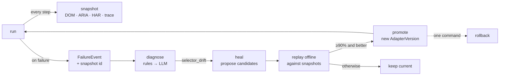

# Self-improvement: see, replay, repair

The agent improves by a fixed loop, in which **nothing is ever tried on the live
site first**:



Phases 10–13 are built. Phases 14 (skill library), 15 (adapter synthesis) and
16 (teaching and metrics) extend the same loop; see [status.md](status.md).

## Phase 10: snapshots everywhere

**Browser** (`applier/snapshot.py`). Every applier step calls
`SnapshotRecorder.capture()`, which writes:

```
snapshots/<run_id>/
  network.har          every request/response of the run (bodies embedded)
  trace.zip            Playwright trace (open with `playwright show-trace`)
  01/dom.html          outerHTML after a short settle
  01/aria.yaml         accessibility tree (Playwright ARIA snapshot)
  01/screenshot.png
  01/meta.json         url, title, intent ("open", "filled", "paused_captcha"…)
  02/…
```

It also writes a `snapshots` row with the page **signature** and **features**.
Failures store `snapshot_id`, so every failure points at the page that caused it.

**API** (`scraper/runner.py`). Each board fetch saves its raw payloads as
`snapshots/scrape-…/api/<source>-<board>.json` with intent `api:fetch`.

**Read-only live capture.** `sachin-agent-applier inspect <job>` opens the real
form without typing anything and captures it. That's how real Greenhouse forms
entered the replay suite.

### Signatures (`shared/signature.py`)

- **Features**: a sparse vector of what's on the page. Tracked tag counts,
  bucketed (1, 2–3, 4–7…); input types; ARIA roles; control ids and names with
  digits collapsed (`question_17919411004` → `question_#`); first words of
  labels and buttons.
- **Signature**: `sig1:` + hash of which *structural* keys are present, ignoring
  counts and label words. Two jobs on the same ATS with different custom
  questions get the **same** signature; a redesigned form gets a **new** one.
  Similarity between pages is the cosine of their feature vectors.
- **API snapshots** fingerprint the JSON key paths (`jobs[].location.name`),
  so a schema change shows up as a new signature.

Measured: same ATS with a changed question → same signature, cosine 0.989; a
login page → different signature, cosine 0.54.

### Offline replay (`sandbox/offline.py`)

`sachin-agent-sandbox replay <snapshot-id>` opens a new browser where:

- the snapshot's URL is served from its saved `dom.html`;
- every other request is answered from the run's HAR, or **aborted**;
- JavaScript is off by default (the captured DOM exactly as it was); `--js`
  turns it on, with scripts coming from the HAR.

Nothing reaches the network; a test checks that `fetch()` fails.
`sachin-agent-sandbox prune` deletes runs older than `SNAPSHOT_RETENTION_DAYS`.

## Phase 11: failure bus and diagnostician

Every module emits `FailureEvent`s through `shared/db/failures.emit_failure`:

- **scraper**: fetch, enrich and normalize errors;
- **matcher**: scoring and tailoring LLM errors;
- **applier**: selector drift, unseen site, submit failures, plus every pause
  that **escalates to you** (CAPTCHA, login, consent, unknown field). Those are
  failures of autonomy, and the escalation rate is how improvement is measured.

`sachin-agent-sandbox diagnose` classifies each undiagnosed event into the
taxonomy: `transient, selector_drift, schema_drift, rate_limit, auth_wall,
captcha, consent, unseen_site, unknown_field, novel_interaction,
semantic_mismatch, unknown`.

1. **Rules** first (`sandbox/diagnose.py`), free and with high confidence:
   429 / "tokens per day" → `rate_limit`; "matched nothing" → `selector_drift`;
   invalid or truncated LLM JSON → `semantic_mismatch`; 5xx / timeouts →
   `transient`; 401/403 → `auth_wall`; normalize KeyError → `schema_drift`;
   board 404 → `unseen_site`; pause phases map one-to-one.
2. **LLM** for the rest. It sees the error, its context, and the snapshot's
   URL and ARIA excerpt, and returns a class, confidence and evidence.
3. The diagnosed class replaces the emitter's guess; the guess, method,
   confidence and evidence go to `FailureEvent.diagnosis`.

`sachin-agent-db failures stats` shows the distribution by class, domain and
module/phase. On the real data so far: 49 failures, all classified;
`rate_limit` 57% (Groq daily quota), `semantic_mismatch` 41% (malformed LLM
JSON, which the emitter had wrongly tagged `transient`; 21 guesses were
corrected), `unseen_site` 2%. That's the **baseline** that later changes are
measured against.

## Phase 12: replay sandbox

- **`replay(snapshot, adapter, assertions)`** (`sandbox/replay.py`) runs
  assertions on an offline page through a `ReplaySession` that **refuses to
  navigate**. A crashing assertion counts as a failing one.
- **Suites** (`sandbox/suites.py`) for an ATS form: form detected, every
  required field resolves, submit resolves, questions extracted.
- **Harness** (`sandbox/harness.py`) runs an adapter against every stored form
  snapshot of a domain (one per distinct page, in one browser) and returns a
  pass rate.
- **`sachin-agent-sandbox suite greenhouse.io [--spec file] [--min-pass 1.0]`**
  exits 1 below the bar *or with no snapshots*. It's the promotion gate.

Live: the Greenhouse adapter passes 5/5 real captured Vercel forms in 3.1s; a
deliberately broken spec passes 0/5.

## Phase 13: selector healing

Trigger: a `selector_drift` failure, meaning a locator matched nothing on a
page that loaded. The failure records which intent broke, the failing locator,
and the adapter version.

`sachin-agent-sandbox heal <failure-id>` (or `--pending`):

1. Loads the failure's snapshot and the domain's **active** spec, and finds
   **every** broken locator on that page: form marker, each required field,
   submit. A site rename usually breaks several at once.
2. **Proposes candidates** for each broken intent from the failing page itself:
   - labels whose text means the intent (`First Name` for `first_name`);
   - controls whose id/name fuzzy-match it (`input#firstName`);
   - for submit, buttons that say "submit". "Apply" is only considered when
     nothing says submit, because it usually *opens* the form.
   - with `--llm`: up to 3 proposals read from the ARIA tree.
3. **Scores each candidate offline** by how often it resolves on:
   - the *evaluation set*: the failing snapshot plus every snapshot with the
     same signature (the site as it is now);
   - the *overall set*: every form snapshot of the domain, including older
     layouts.

   Ties go to label, then role, then CSS, since visible labels survive markup
   changes.
4. Builds a **composite spec** from the best candidate per intent and runs the
   full replay suite on it.
5. **Promotes** only if it passes **≥90%** of the evaluation set **and** beats
   the active version there. The new version is a JSON file in
   `data/adapters/<domain>/v<N>.json` plus an `adapter_versions` row: parent,
   fix summary, every trial with its rates, pass rate,
   `source = "synthesized"`. It becomes active, and the failure is marked
   `healed_by`.

`sachin-agent-applier adapters greenhouse.io` shows the version history
(`*` = active). `sachin-agent-applier rollback greenhouse.io 1` restores any
version; nothing is ever deleted.

Live demo: a deliberately broken spec (`input#firstName`) was healed from real
Vercel snapshots in 15s and promoted as v3 (label `First Name`, 100% on all
snapshots). It was then confirmed on the live form read-only with `inspect`,
and rolled back to v1.
